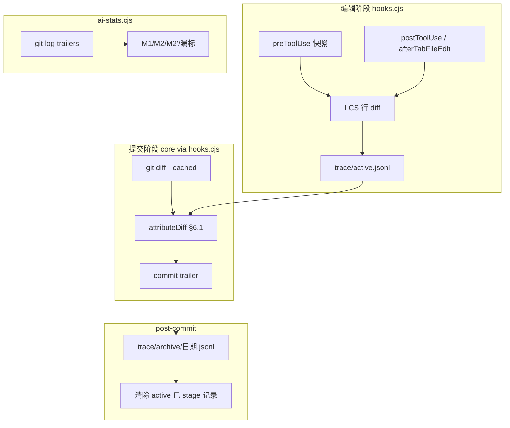

# AI 代码率统计 — 技术设计（V1.1）

| 字段 | 内容 |
|------|------|
| 状态 | 已确认，待实施 |
| 日期 | 2026-06-30 |
| PRD | `local-doc/AI 代码率统计-需求描述.md` V1.1 |
| 业务文件 | **3 个**（`core.cjs`、`hooks.cjs`、`ai-stats.cjs`） |

---

## 1. 目标与约束

### 1.1 目标

在 Cursor + Git 工作流下，自动采集 Agent 工具调用产生的代码变更，于 commit 时写入 trailer，支持离线汇总 M1/M2/M2'/漏标率。Tab 编辑**不采集**（后文 §4.1 说明理由）。

### 1.2 硬约束

| 约束 | 说明 |
|------|------|
| Git 为统计真源 | trailer 随 commit 扩散，不依赖中央库 |
| 只采集 AI | 人工不写入 trace；人工行 = 差集 |
| 业务文件 ≤ 3 | 全部在 `.cursor/hooks/ai-stats/` |
| test 不提交 | `test/` 本地 + gitignore |
| 无 setup.cjs | 配置见 PRD 附录 B + 本文 §8 |
| 归因 V1.1 | hash 交集 + 同逻辑行 del/add 整对算 AI |

---

## 2. 目录结构

```text
.cursor/hooks/ai-stats/
├── core.cjs                 # [1/3] 纯逻辑库
├── hooks.cjs                # [2/3] Cursor + Git 入口
├── ai-stats.cjs              # [3/3] 汇总 CLI
├── prepare-commit-msg       # 硬链接 → hooks.cjs
├── post-commit              # 硬链接 → hooks.cjs
├── ai-stats.exclude.json    # 可选
├── trace/
│   ├── active.jsonl
│   ├── archive/YYYY-MM-DD.jsonl
│   └── snapshots/           # Write 前基线（gitignore）
├── reports/                 # gitignore
└── test/                    # gitignore，不提交
```

---

## 3. 架构与数据流



### 3.1 文件职责

| 文件 | 职责 | 禁止 |
|------|------|------|
| `core.cjs` | hash、LCS diff、trace I/O、attributeDiff、trailer 构建/解析、Git hook 业务函数 | 不直接读 Cursor stdin |
| `hooks.cjs` | 解析 stdin/argv；分发 Cursor/Git；调用 core | 不含报表逻辑 |
| `ai-stats.cjs` | `--since` / `--json` / `--md` | 不写 trace、不改 Git |

### 3.2 `hooks.cjs` 入口分发

```javascript
const hookName = path.basename(process.argv[0] || '');
if (/prepare-commit-msg/i.test(hookName)) {
  require('./core.cjs').runPrepareCommitMsg(process.argv.slice(2));
} else if (/post-commit/i.test(hookName)) {
  require('./core.cjs').runPostCommit();
} else {
  require('./core.cjs').runCursorHook(readStdinJson());
}
```

---

## 4. 采集层

### 4.1 `.cursor/hooks.json` 注册

| 事件 | matcher | command |
|------|---------|---------|
| `preToolUse` | `Write\|StrReplace` | `node .cursor/hooks/ai-stats/hooks.cjs` |
| `postToolUse` | `Write\|StrReplace` | 同上 |
| `afterFileEdit` | （无 matcher） | 同上 |

**采集路径：** Agent 的 `StrReplace` 在 Cursor 实现中常**只触发 `afterFileEdit`**，不触发 `postToolUse`（官方 `postToolUse` matcher 工具列表不含 StrReplace）。因此 `afterFileEdit` 必须采集，优先用 payload 中的 `edits[]`，降级时回退磁盘 diff。

**不采集：** `afterTabFileEdit`（Tab 补全）在实现层直接 return——无法区分 Tab AI 建议与用户手动输入，宁漏勿滥。

### 4.2 trace 记录格式

```json
{
  "v": 1,
  "ts": "2026-06-30T12:00:00.000Z",
  "source": "agent",
  "tool": "StrReplace",
  "file": "skyworkshop-backend/src/main/resources/测试.txt",
  "fileKey": "skyworkshop-backend/src/main/resources/%E6%B5%8B%E8%AF%95.txt",
  "lines": [
    { "op": "add", "hash": "sha256..." },
    { "op": "del", "hash": "sha256..." }
  ]
}
```

- `source`: 固定 `agent`（Tab 编辑不采集，见 §4.1）
- `file`: 可读 UTF-8 仓库相对路径（调试、日志）
- `fileKey`: **匹配键**，所有 trace 对账、快照索引、归档清理均用 `fileKey`（见 §4.2.1）
- 不存行原文，仅存 hash
- Write 必须 `preToolUse` 快照 + 行级 diff，禁止整文件 add

#### 4.2.1 路径 canonical key（`toFileKey`）

中文路径在 Cursor Hook stdin、Git diff、JSON 各层可能出现不同表示，统一经 `toFileKey()` 再比较：

```text
原始路径 → normalizeGitPath（Git 八进制转义、反斜杠）
         → Unicode NFC
         → 按 / 分段 encodeURIComponent
         → fileKey（纯 ASCII）
```

| 环节 | 规则 |
|------|------|
| 采集写入 | `resolveHookTargetPath` 得 `file` 后，同时写 `fileKey: toFileKey(file)` |
| 快照 | `snapshots/` 文件名 = SHA256(fileKey) |
| prepare-commit-msg | staged diff 的 `file` 经 `toFileKey` 与 trace 匹配 |
| 旧 trace 兼容 | 无 `fileKey` 时运行时 `toFileKey(record.file)` 降级 |
| 旧快照兼容 | 读快照时 fallback 旧 SHA256(raw file) |

**限制**：若 Cursor 传入乱码且磁盘解析失败，`file` 与 Git staged 仍可能不一致；`fileKey` 不能修复输入层乱码，须配合 `resolveHookTargetPath` 兜底。

### 4.3 行 hash 规范

1. CRLF → LF
2. trim 行尾空白
3. 空行跳过
4. SHA256(normalized_line)

### 4.4 生命周期

| 事件 | 行为 |
|------|------|
| Agent 改文件 | append → `active.jsonl` |
| `git commit` 成功 | 归档 staged 文件 trace → archive；从 active 删除；清 snapshots |
| 部分 stage | 仅 staged 对账；未 stage trace 保留 |
| `--amend` | 重算 trailer |
| rebase | 不重算（backlog） |

### 4.5 失败策略（采集）

Cursor Hook 异常：**fail-open**，exit 0，不阻断 Agent。

---

## 5. 对账与 trailer

### 5.1 `prepare-commit-msg` 流程

1. `parseNumstat()` → `Lines`, `Files`
2. `parseStagedDiff(-U0)` → 逐行 hunk + hash
3. `loadActiveTrace(stagedFiles)`
4. `attributeDiff(staged, traces)` → `aiAdded`, `aiDeleted`, `aiFiles`
5. `buildTrailer()` → 追加至 commit message 末尾

### 5.2 行归因算法（V1.1）

**规则 A — 不同逻辑行**

- staged hash 命中 trace 同 `op` → AI
- 未命中 → 人工

**规则 B — 同一逻辑行**

- staged 相邻 `del` + `add` 为一对
- trace 命中该对任一 hash → 整对计 AI
- 均未命中 → 整对计人工

**规则 C — 上界**

```text
AI-Lines-Added   = min(计数, staged add 行数)
AI-Lines-Deleted = min(计数, staged del 行数)
与 Lines(numstat) 再取 min（防夸大）
```

**人工行（报表）**

```text
人工行 = Lines − (AI-Lines-Added + AI-Lines-Deleted)
```

### 5.3 `AI-Authored` 判定

| 值 | 条件 |
|----|------|
| `yes` | `aiAdded + aiDeleted > 0` |
| `no` | 无 AI 行 |
| `unknown` | 对账/写 trailer 异常 |

### 5.4 trailer 字段

见 PRD §5.1。`AI-Authored: no` 时仅写 `AI-Authored`、`Lines`、`Files`。

### 5.5 对账失败

不阻断 commit；写 `unknown` + `Lines` + `Files`；stderr 可见提示。

---

## 6. 汇总层（`ai-stats.cjs`）

### 6.1 命令

```bash
node .cursor/hooks/ai-stats/ai-stats.cjs --since 7d
node .cursor/hooks/ai-stats/ai-stats.cjs --since 7d --json
node .cursor/hooks/ai-stats/ai-stats.cjs --since 7d --md
```

### 6.2 指标

| 指标 | 公式 |
|------|------|
| M1 | `yes` commit 数 / 有效 commit 数 |
| M2 | Σ(AI-Lines-*) / Σ(Lines) |
| M2' | M2 + §5.2 有效行过滤（仅报表） |
| 漏标率 | `unknown` / 有效 commit |
| 人工 | 报表层差集 |

排除规则：PRD §6.5 + `ai-stats.exclude.json`。

聚合：作者、日期、AI/人工（PRD F-24）。

---

## 7. `core.cjs` 模块分区

```text
§ hash + normalizeLine
§ diffLineOps (LCS)
§ path: toFileKey, traceFileKey, normalizeGitPath
§ trace: appendActive, loadActive, archiveStaged, clearStaged
§ snapshot: write/read/consume (keyed by fileKey)
§ collect: linesFromToolInput
§ attributeDiff (规则 A/B/C，按 fileKey 索引)
§ trailer: parseNumstat, parseStagedDiff, buildTrailer, injectTrailer
§ runCursorHook, runPrepareCommitMsg, runPostCommit
§ parseTrailersFromLog (供 ai-stats.cjs)
module.exports
```

---

## 8. 首次配置（开发者）

1. `git config core.hooksPath .cursor/hooks/ai-stats`
2. 创建硬链接（Windows）：
   ```powershell
   cd .cursor/hooks/ai-stats
   cmd /c mklink /H prepare-commit-msg hooks.cjs
   cmd /c mklink /H post-commit hooks.cjs
   ```
3. （可选）`CURSOR_USER_EMAIL`
4. 重启 Cursor
5. Agent 改文件 → commit → `git log -1` 检查 trailer

---

## 9. 仓库联动（实施时）

| 文件 | 动作 |
|------|------|
| `.cursor/hooks.json` | 注册 ai-stats |
| `.gitignore` | `trace/`、`reports/`、`test/` |
| `.cursor/rules/提交规范.mdc` | AI trailer 规范 |
| `AGENTS.md` / `docs/MAINTENANCE.md` | 索引 + 配置步骤 |

---

## 10. 测试策略

| 项 | 说明 |
|----|------|
| 位置 | `.cursor/hooks/ai-stats/test/`（unit + scenarios + fixtures） |
| Git | **不提交** test/ |
| 入口 | `node test/run-tests.cjs` → 6 suites，≥25 用例 |
| 覆盖 | UT-01~11 + AC-03~06,08~10,04b + SC/LC/RP；详见 plan §自动化测试用例清单 |
| 编码 | UT-05~08 含 BOM/中文/Windows 路径 fixture；UT-fileKey 含 toFileKey/对账匹配 |
| CI | 不跑 |
| 门禁 | 修改 `core.cjs` 后必跑全量测试 |

---

## 11. 验收映射

| AC | 验证点 |
|----|--------|
| AC-01~02 | Agent 改 + commit → `yes` + AI-Lines |
| AC-03 | 纯人工 → `no` |
| AC-04 | 不同行混改 → 仅 AI 行进 trailer |
| AC-04b | 同线混改 → del+add 整对 AI |
| AC-05 | 部分 stage → 未 stage trace 保留 |
| AC-06 | amend 重算 |
| AC-09 | 损坏 trace → `unknown` + 提示 |

---

## 12. 已知边界

| 场景 | 行为 |
|------|------|
| format-on-save 改 hash | 可能计人工 |
| Tab 补全 | 不采集（见 §4.1） |
| rebase | trailer 可能过时 |
| 相同内容两行 | 极少数 hash 碰撞 |

---

## 13. 不在本期

- setup.cjs、probe 脚本入库
- test/ 提交
- rebase trailer 重算
- CI 自动周报
- 多 AI 工具（trace `tool` 字段预留扩展）
